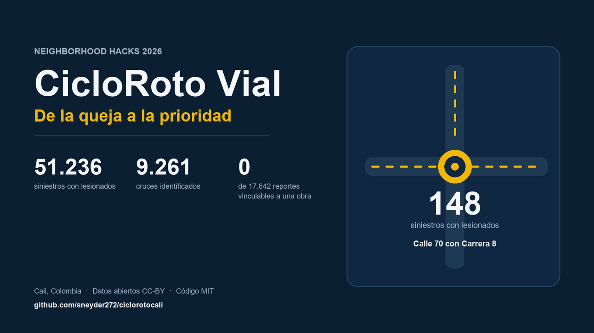

# CicloRoto Vial

**De la queja a la prioridad: dónde se lesiona la gente en Cali y qué no se puede verificar con los datos públicos.**

> **Demo en 30 segundos:** abre la app, escribe `CL 70 & CRA 8`, mira los
> **148 siniestros** de esa esquina y descarga la ficha con la solicitud lista
> para radicar. La pestaña **Trazabilidad** muestra por qué **0 de 17,642**
> reportes se pueden vincular a una obra publicada.



CicloRoto Vial procesa 51,236 registros de siniestros con lesionados (2016–2025)
publicados por la Secretaría de Movilidad de Cali, consolida las direcciones en
cruces reales y produce dos resultados:

1. **Un ranking de cruces críticos**, con tasa ajustada e intervalo de confianza.
2. **Una ficha por cruce**, con los datos y una solicitud lista para radicar.

La segunda capa del proyecto audita las obras publicadas: muestra que hoy no es
posible verificar si la ciudad intervino en esos cruces, porque las fuentes no
comparten clave, fecha ni identificador de caso.

## El problema

Cali publica los siniestros viales con dirección textual, pero no publica un
registro de intervenciones con la misma granularidad. Un vecino puede saber que
su esquina es peligrosa, pero no puede comprobar si pidió una obra, si se hizo o
si existe un estudio de seguridad vial para ese punto.

CicloRoto Vial cierra la primera mitad —saber dónde— y hace visible la segunda
—no poder verificar—. No inventa el vínculo que falta.

## Resultados verificables

| Métrica | Valor |
|---|---:|
| Siniestros con lesionados (2016–2025) | **51,236** |
| Direcciones resolubles a un cruce | **28,411** (55.5%) |
| Cruces distintos | **9,261** |
| Cruce más crítico | **Calle 70 con Carrera 8** |
| Registros en ese cruce | **148** |
| Motocicleta en ese cruce | 41.2% |
| Peatón en ese cruce | 12.8% |
| Reportes ciudadanos vinculables a una obra | **0 de 17,642** |

Top 5 de cruces:

| # | Cruce | Registros | % moto |
|---:|---|---:|---:|
| 1 | Calle 70 con Carrera 8 | 148 | 41.2% |
| 2 | Carrera 23 con Transversal 25 | 125 | 46.4% |
| 3 | Calle 70 con Carrera 1 | 118 | 39.8% |
| 4 | Calle 34 con Carrera 1 | 107 | 45.8% |
| 5 | Calle 70 con Carrera 28D | 99 | 45.5% |

## Impacto y uso

Tres perfiles usan el mismo resultado:

1. **Un vecino** busca su esquina, entiende el riesgo y descarga una ficha con
   una solicitud lista para radicar.
2. **Una autoridad o un periodista** usa el ranking y el CSV para priorizar
   entre **1,228 cruces** con al menos 5 registros, en lugar de elegir por
   percepción.
3. **Una organización comunitaria** usa el hallazgo de “0 vinculables” para
   pedir que las obras se publiquen con dirección, fecha e identificador de
   caso.

El objetivo no es reemplazar una auditoría vial ni probar causalidad. Es
convertir un dato disperso en una pregunta verificable. Ver
[`docs/impact.md`](docs/impact.md).

## Cómo funciona

```text
CSV de lesionados (51,236)
        ↓
Normalización de direcciones (CRA→CARRERA, CL→CALLE, &, sin conector)
        ↓
Resolución de entidades: 'CARRERA 8 CON CALLE 70' = 'CALLE 70 CON CARRERA 8'
        ↓
Agregación por cruce
        ↓
Modelo Gamma-Poisson (empirical Bayes) → tasa ajustada + IC 95%
        ↓
Ranking + ficha + solicitud
```

### El modelo, en una frase

Cada cruce tiene un conteo observado. El modelo jerárquico Gamma-Poisson estima
su tasa esperada tomando información del promedio de la ciudad, y devuelve un
intervalo del 95%. Sirve para no presentar un conteo aislado como si fuera una
tasa estable. **No corrige por volumen de tráfico**, porque ese dato no está
publicado.

## Instalación y ejecución

Requiere Python 3.10 o superior.

```bash
pip install -r requirements.txt
python -m streamlit run app.py
```

Los CSV están incluidos en `data/raw/`. La aplicación **no necesita internet**
para abrirse.

Pruebas (dependencias de desarrollo):

```bash
pip install -r requirements-dev.txt
pytest -q
```

## Estructura

```text
cicloroto/
├── core/
│   ├── pipeline.py       # lectura local, normalización, fechas
│   └── trazabilidad.py   # motor de cruce para módulos con período común
├── modules/
│   ├── vial.py           # siniestralidad: ranking, modelo, ficha
│   └── alumbrado.py      # auditoría de obras publicadas
├── data/
│   ├── raw/              # CSV originales
│   └── sources.csv       # catálogo de fuentes
├── docs/audit.md         # auditoría de datos y descartes
├── tests/
├── app.py
├── LICENSE
└── README.md
```

## Fuentes

> **Estado del portal (2026-10-22):** las tres URLs de `datos.cali.gov.co`
> devolvieron un comunicado oficial de **suspensión temporal de servicios web
> por medidas de seguridad** (fechado 2026-10-21). Los CSV se descargaron el
> 17 y el 19 de octubre, antes de la suspensión, y están incluidos en el
> repositorio con SHA-256. Capturas y detalle:
> [`docs/evidence/sources.md`](docs/evidence/sources.md).

| ID | Conjunto | Registros | Período | Enlace | Licencia |
|---|---|---:|---|---|---|
| V01 | Lesionados en accidentes de tránsito | 51,236 | 2016–2025 | [CKAN](https://datos.cali.gov.co/dataset/75c089ba-7df3-4816-b80f-c69c6e5362ae) | CC-BY |
| A01 | Proyectos de alumbrado público | 247 | 2017 | [CKAN](https://datos.cali.gov.co/dataset/e6a3fd08-6a44-422f-beb7-d21ac1f38ec1) | CC-BY |
| A02 | PQR por comuna | 17,642 | 2024–2025 | [CKAN](https://datos.cali.gov.co/dataset/de6fa620-eda6-47c8-97ae-bcbbed493fe1) | CC-BY |

Fechas de consulta: **2026-10-17** (V01) y **2026-10-19** (A01, A02).
Catálogo completo en [`data/sources.csv`](data/sources.csv).
Auditoría y descartes en [`docs/audit.md`](docs/audit.md).

## Límites

- Solo **55.5%** de los registros tienen dirección resoluble a cruce. El resto
  son direcciones vacías (`"."`), clínicas, CAI o texto no interpretable.
- **2018, 2019 y 2020 no tienen dirección** en la fuente. El ranking se apoya
  en 2016, 2017 y 2021–2025.
- 2025 está incompleto.
- No hay coordenadas ni volumen de tráfico: no hay mapa ni normalización por
  exposición.
- Un registro es un **siniestro**, no una persona.
- El ranking **no** prueba que falte una obra. Indica dónde priorizar la
  verificación y qué no se puede comprobar con lo publicado.
- `0 reportes vinculables` significa "no verificable con estas fuentes", no
  "problema sin resolver".

## Video y material

- Guion y tomas: [`docs/video_script.md`](docs/video_script.md) y
  [`docs/shot_list.md`](docs/shot_list.md).
- Portadas, textos y narraciones sintéticas: [`video/`](video/).
- Transcripción: [`docs/transcript.md`](docs/transcript.md).
- Copy para Devpost: [`docs/devpost_form.md`](docs/devpost_form.md).

La narración es sintética (`edge-tts`) y se declara en la submission. La
grabación de pantalla debe ser real; el material de `video/` no sustituye la
demo.

## Reproducibilidad

Desde un clon limpio:

```bash
python -m venv .venv
# Windows: .venv\Scripts\activate
# Linux/macOS: source .venv/bin/activate
pip install -r requirements.txt -r requirements-dev.txt
pytest -q
python scripts/verificar_checksums.py
python -m streamlit run app.py
```

Resultado esperado: **16 passed**; los tres CSV deben imprimir `OK`; la app
responde `ok` en `http://localhost:8501/_stcore/health`. Los CSV están
normalizados a LF con `.gitattributes`, así que los hashes son iguales en
Windows, Linux y macOS. Guía completa:
[`docs/reproducibility.md`](docs/reproducibility.md).

## Licencias

- **Código:** MIT. Ver [`LICENSE`](LICENSE).
- **Datos:** CC-BY, Alcaldía de Santiago de Cali / Secretaría de Movilidad.
  La licencia de los datos no cubre el código ni viceversa.

## Uso de IA

La asistencia de IA se usó para exploración, redacción y revisión de código.
Las cifras del README se verifican con `pytest` y con `docs/audit.md`; ninguna
se genera sin pasar por los CSV locales.
